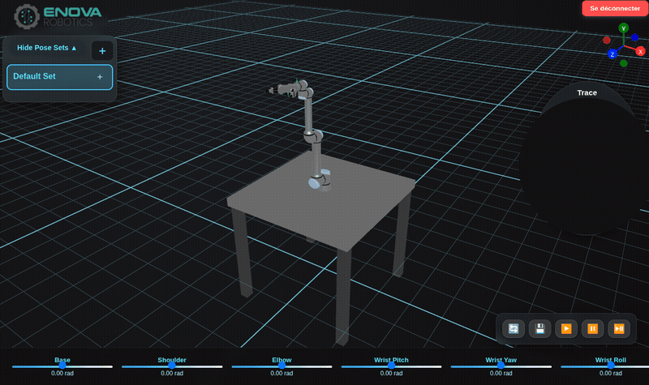
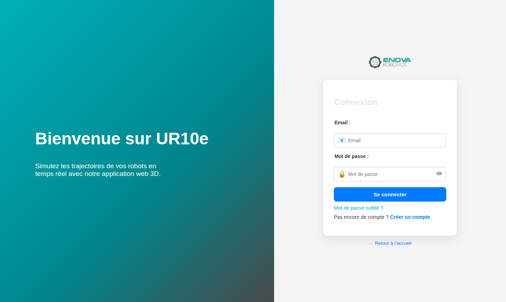

# UR10e Web Simulator

A browser-based 3D simulator for the **Universal Robots UR10e** collaborative arm, built during my internship at **Enova Robotics** (Tunisia, July – August 2025).

Engineers can move each of the robot's six joints in real time, save poses into sets, and replay them as trajectories, without touching the physical robot.



---

## Impact

- **Delivered two weeks ahead of schedule** and adopted by Enova's R&D team
- The team reported a **30% reduction in physical testing** on the real arm

## Features

- **Real-time 3D arm control:** one slider per joint (base, shoulder, elbow, wrist pitch, yaw, roll), rendered with Three.js
- **End-effector tracking:** follows the tool's absolute position as the arm moves, with a trace view
- **Pose sets:** create, edit, save and replay sequences of poses (play / pause / step)
- **Accounts and access control:** login with JWT-protected API routes

| Simulation | Login |
|---|---|
|  |  |

## Architecture

The whole stack runs with **Docker Compose**:

```
                 ┌───────────────────────────────┐
  Browser ─────▶ │ frontend  (Nginx :3000)       │  React build served by Nginx
                 │  /api/* ─────────────┐        │  /api reverse-proxied to backend
                 └──────────────────────┼────────┘
                                        ▼
                 ┌───────────────────────────────┐      ┌──────────────┐
                 │ backend  (Spring Boot :8080)  │ ───▶ │ MongoDB :27017│
                 │ REST API · Spring Security    │      │ users,       │
                 │ JWT auth                      │      │ posesets     │
                 └───────────────────────────────┘      └──────────────┘
                        ▲
  api-proxy (Nginx :5000) ─┘  extra reverse proxy for API clients
```

| Layer | Technologies |
|---|---|
| Frontend | React 18, Three.js with React Three Fiber / Drei, Zustand, React Router |
| Backend | Java 17, Spring Boot, Spring Security, JWT |
| Database | MongoDB 7 |
| Containers | Multi-stage Dockerfiles (Node → Nginx, Maven → JRE), Docker Compose, Nginx reverse proxy |
| 3D pipeline | FreeCAD → Blender (rigging, joint hierarchy) → GLB |
| Testing | Postman (API), MongoDB Compass (data) |

## Engineering challenges

**Making the 3D model animatable.** The available UR10e model wasn't rigged. I prepared it in FreeCAD, then rigged it in Blender with a proper joint hierarchy (each link parented to the previous one) and exported it to GLB, so each joint could be rotated independently in the browser.

**A blank screen with no obvious cause.** The app crashed with `Cannot read properties of null (reading 'useRef')`. I traced it to React 19 being installed by accident, which was incompatible with `react-router-dom`. I rebuilt the project on React 18 in a clean setup.

**Frontend–backend integration.** Early on, data wasn't coming through and JWT made testing harder. I adjusted the API routes and token handling step by step, validating each endpoint in Postman and checking the stored data in MongoDB Compass.

**Containerising the stack.** I wrote multi-stage Dockerfiles for both apps and a Compose file wiring the frontend, backend, MongoDB and an Nginx reverse proxy together, so the platform starts with one command.

## What I'd improve next

Looking back with more experience, these are the changes I'd make before production use:

- Hash passwords with BCrypt instead of comparing them directly
- Move the JWT secret and database URI into environment variables or a secrets manager
- Read the API URL from configuration instead of hard-coding `localhost:8080` in the frontend
- Add a CI pipeline (build, tests, image publishing)

## Source code

This project was developed for Enova Robotics during an internship, so **the source code is private**. I'm happy to walk through it or arrange a code review on request.

## Author

**Islem Azzouz**, Cloud & DevOps engineering student at ESPRIT
[Portfolio](https://islemazz.github.io) · [LinkedIn](https://www.linkedin.com/in/islem-azzouz-483265359) · [GitHub](https://github.com/islemazz)
